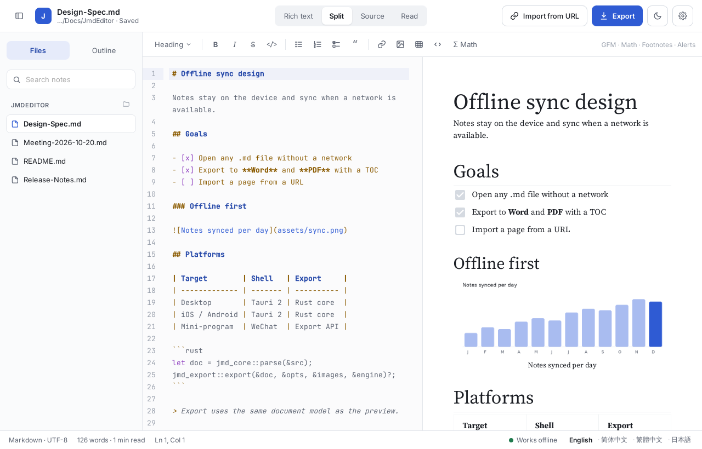
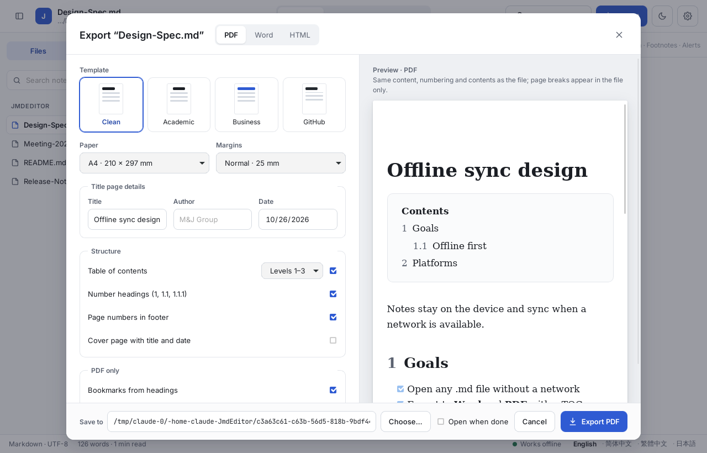
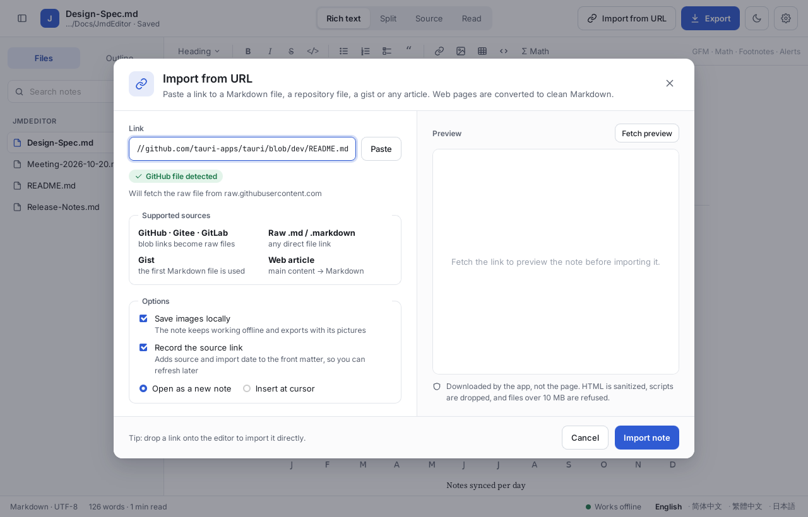
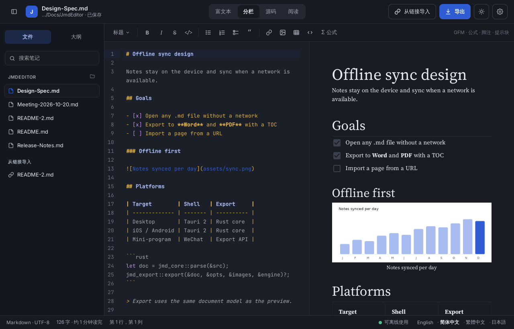
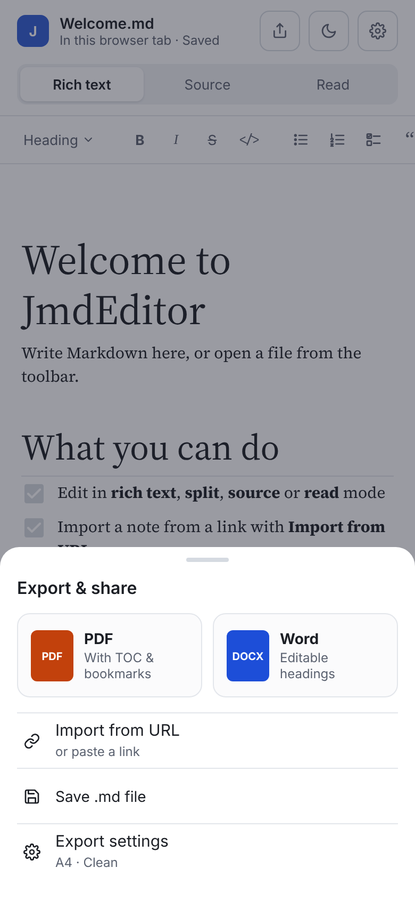

# JmdEditor

An offline Markdown editor by **M&J Group** for Windows, macOS, Linux, iOS and Android, plus a WeChat mini-program reader. Open or import a note, edit it, and export it to **Word** or **PDF** with a real table of contents.



## Features

- **Four editor modes**: Rich text (Milkdown), Split (CodeMirror source with a live preview), Source, and Read. Read uses the export renderer, so numbering and contents match the exported files.
- **Import from URL**: GitHub, Gitee and GitLab file links, gists, raw `.md` links and web articles become a new note. Images can be saved next to the note, and the source link and date go into the front matter. Links are fetched by the Rust side with private-network, size, time and redirect limits.
- **Export to Word, PDF and HTML**: four templates (Clean, Academic, Business, GitHub), A4 or Letter, a table of contents, numbered headings, page numbers, an optional cover page, PDF bookmarks, PDF/A, and Chinese and Japanese text. Word files use real Heading styles and an updatable TOC field. Math, tables, code, task lists, footnotes, GitHub alerts and images are supported.
- **Works offline** on desktop and mobile. Fonts ship with the app.
- **Four languages**: English, 简体中文, 繁體中文 and 日本語, plus light and dark themes and an accent colour.
- **Browser build and hosted API**: the same UI runs in a browser against `jmd-server`, which also serves the mini-program.
- **WeChat mini-program**: open a note from a link or a chat file, read it, export PDF or Word, then open it or send it to a chat. An About page introduces the app and copies desktop download links.

| Export dialog | Import from URL |
| --- | --- |
|  |  |
| **Dark theme, Simplified Chinese** | **Phone layout** |
|  |  |

## Repository layout

```
apps/desktop          Vue 3 UI shared by desktop, mobile and the browser build
  src/platform/       Tauri commands, or HTTP calls to jmd-server in a browser
  src-tauri/          Tauri 2 shell: files, dialogs, import, export, settings
apps/miniprogram      Native WeChat mini-program (no build step)
crates/jmd-core       Markdown (comrak, GFM) to one document model; outline, stats
crates/jmd-import     Link resolving, safe fetching, HTML to Markdown, images
crates/jmd-export     Word (docx-rs), PDF (Typst) and HTML from the model
crates/jmd-server     Axum API: /api/import, /api/export, /api/render, /api/resolve
docs/v1               Plan, decisions and progress log
```

Every exporter reads the same `jmd_core::Document`, so the preview, the Word file and the PDF keep the same order, numbering and contents.

## Getting started

Requirements: Rust 1.85+, Node 22, pnpm 10, and the [Tauri 2 prerequisites](https://v2.tauri.app/start/prerequisites/) for your platform.

```bash
pnpm install
pnpm tauri dev                      # desktop app with hot reload
pnpm test                           # UI and mini-program tests
cargo test --workspace              # Rust tests
```

Release builds:

```bash
scripts/fetch-fonts.sh              # Noto Sans/Serif CJK for PDF export (pinned, checksummed)
pnpm tauri build                    # installers in target/release/bundle
```

Mobile (needs Xcode or the Android SDK and NDK):

```bash
pnpm tauri android init && pnpm tauri android dev
pnpm tauri ios init && pnpm tauri ios dev
```

Pushing a tag such as `v0.1.0` runs `.github/workflows/release.yml`, which builds macOS, Windows and Linux installers and publishes the release once all three have built. Code signing and notarisation are not configured yet. After a release, set `DESKTOP_VERSION` in `apps/miniprogram/config.js` so the mini-program's download links match.

## Export API (`jmd-server`)

```bash
pnpm build                                            # browser UI into apps/desktop/dist
JMD_STATIC=apps/desktop/dist cargo run -p jmd-server  # http://127.0.0.1:8787
```

Or with Docker: `docker build -f crates/jmd-server/Dockerfile -t jmd-server . && docker run -p 8787:8787 jmd-server`.

| Variable | Default | Meaning |
| --- | --- | --- |
| `JMD_ADDR` | `127.0.0.1:8787` | Listen address |
| `JMD_STATIC` | none | Folder with the browser build to serve at `/` |
| `JMD_FONT_DIRS` | none | Extra font folders for PDF export (`:`-separated) |
| `JMD_CORS_ORIGINS` | any | Comma-separated browser origins allowed to call the API |
| `JMD_MAX_CONCURRENT` | CPU count (max 8) | Exports running at once |
| `JMD_EXPORT_TIMEOUT_SECS` | `60` | Longest export |
| `JMD_RATE_PER_MIN` | `60` | Calls per client address per minute (`0` turns it off) |
| `JMD_TRUST_PROXY` | off | Read the client address from `X-Forwarded-For` |

Notes are limited to 5 MB. Imported links follow the same rules as the desktop app: no private or loopback addresses, 10 MB, 15 s, 5 redirects.

## WeChat mini-program

1. Deploy `jmd-server` behind HTTPS.
2. Set `API_BASE` in `apps/miniprogram/config.js`.
3. In the mini-program admin console, add that domain under 开发管理 → 开发设置 → 服务器域名 (request and downloadFile).
4. Open `apps/miniprogram` in WeChat DevTools and replace `touristappid` in `project.config.json` with your AppID.

## 中文简介

JmdEditor 是 M&J Group 出品的离线 Markdown 编辑器，支持 Windows、macOS、Linux、iOS、Android，并提供微信小程序阅读器。主要功能：

- 富文本、分栏、源码、阅读四种模式；
- 从 GitHub、Gitee、GitLab、Gist、原始 .md 链接或网页文章导入笔记，可将图片保存到本地；
- 导出 Word、PDF、HTML，支持目录、标题编号、页码、封面、书签、PDF/A，以及中文和日文；
- 界面支持简体中文、繁體中文、English、日本語，浅色和深色主题；
- 微信小程序：从链接或聊天文件打开笔记，导出 PDF 或 Word 后可直接打开或发送给朋友；“关于”页面介绍应用，并可复制电脑版下载链接。

## License

MIT © 2026 M&J Group. Bundled fonts (Inter, Source Serif 4, JetBrains Mono, Noto CJK) are under the SIL Open Font License.
